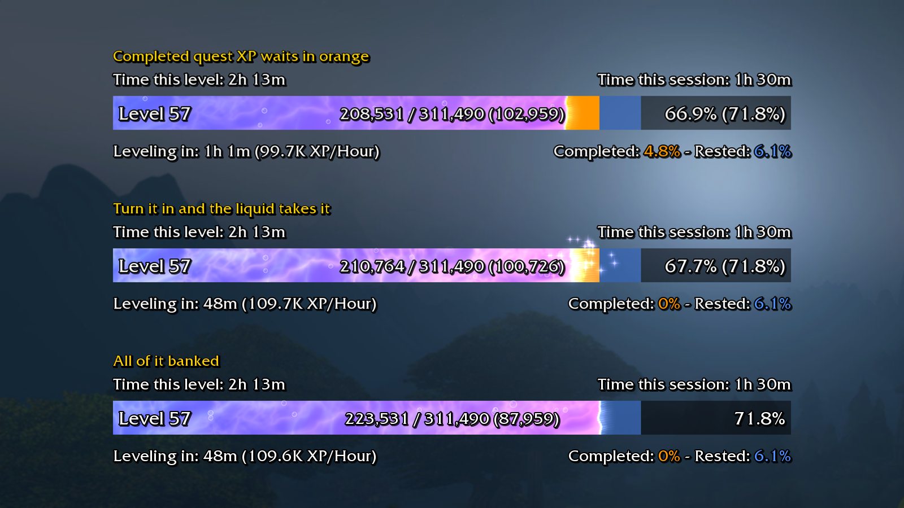
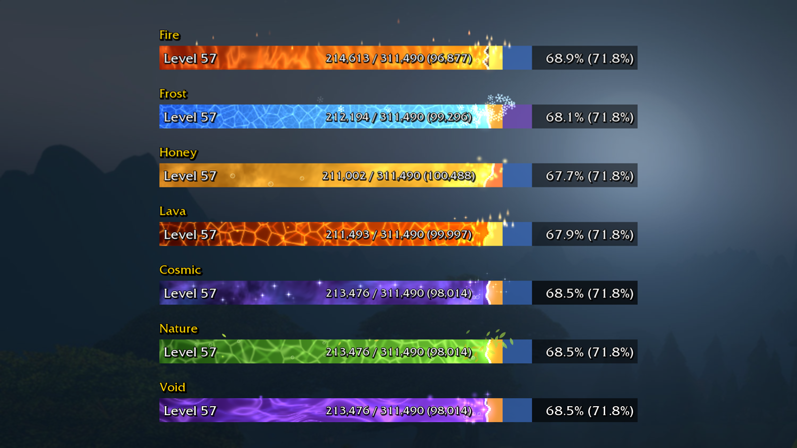

<p align="center"></p>

<p align="center">
  <a href="https://www.curseforge.com/wow/addons/smooth-experience-bar">Get the addon</a> ·
  <a href="branding/gallery">Screenshots</a>
</p>

# Smooth Experience Bar

A lightweight standalone take on the
[Luxthos Experience Bar](https://wago.io/LuxthosExperienceBar) WeakAura, with quest and rested XP, session
stats and optional themes. No WeakAuras required.

Works on **WoW Classic Era**, **TBC Anniversary** and **WoW Forever**.



## What it shows

- **Everything at a glance:** level, current / max XP with XP remaining, and percentage, including what your
  completed quests will bring you to.
- **Completed quest XP:** a separate segment for the XP waiting in your quest log, ready to turn in.
- **Rested XP:** its own segment and a percentage.
- **Session stats:** time this level, time this session, XP per hour and an estimated time to level.
- **Max level:** hide the bar, or keep it as a full bar showing total time played.

## Lightweight

- Standalone: no libraries and no WeakAuras.
- Only updates when something changes; once the bar settles it drops to a low update rate.
- Every visual effect can be switched off on its own for a clean, static bar.

## Make it yours

Open the settings with `/seb`, by right-clicking the bar, or from Options > AddOns > Smooth Experience Bar.

- Unlock to drag the bar anywhere and resize it from the corner, or set width, height and scale exactly.
- Toggle each line of text, or hide the default experience bar.
- Change the fill speed, or switch the liquid waves, swirl, bubbles, sparkles, ambient particles and level-up
  flash on and off.
- Preview XP gains, quest turn-ins and level-ups without touching your real XP.



## Themes

The default theme matches the original WeakAura. 24 more are optional:

- **Smart:** Class Color, Faction, Item Quality (changes colour as the bar fills) and Prismatic
- **Colour:** Arcane, Fel, Holy, Blood, Ember, Tidal, Plague, Midnight and Sunset
- **Outland:** Zangarmarsh, Netherstorm, Hellfire and Nagrand
- **Effects:** Fire, Frost, Honey, Lava, Cosmic, Nature and Void, each with its own particles and liquid feel

## Commands

| Command | |
|---|---|
| `/seb` | Open settings |
| `/seb lock` / `/seb unlock` | Lock or unlock moving and resizing |
| `/seb reset` | Reset position and size |
| `/seb session` | Reset session time and XP/hour |
| `/seb test` | Preview an XP gain (also `level`, `multi`, `quest`, `turnin`, `rested`, `off`) |

## Credits

Layout and design are based on the [Luxthos Experience Bar](https://wago.io/LuxthosExperienceBar) WeakAura by
Luxthos & Daemoos. Smooth Experience Bar is not affiliated with or endorsed by Blizzard Entertainment.

---

## Development

| Folder | What it is |
|---|---|
| `SmoothExperienceBar/` | The addon. `Themes.lua` holds the themes, `Liquid.lua` the liquid, `Options.lua` the settings page |
| `tools/make_media.py` | Generates the textures in `SmoothExperienceBar/Media/` |
| `tools/harness/` | A WoW API mock that runs the addon outside the game: tests, previews and the gallery |
| `branding/` | Icon, gallery screenshots and the backdrop they are drawn on; see its README |

To try the source in game, link or copy `SmoothExperienceBar/` into
`World of Warcraft/<_classic_era_ | _anniversary_ | _forever_>/Interface/AddOns/`.

```powershell
python -m venv tools/venv
tools/venv/Scripts/python -m pip install lupa numpy pillow

python tools/make_media.py SmoothExperienceBar/Media                                       # textures
tools/venv/Scripts/python tools/harness/slash_test.py SmoothExperienceBar                  # tests
tools/venv/Scripts/python tools/harness/run.py SmoothExperienceBar preview theme=fel       # preview.gif + sheet.png
tools/venv/Scripts/python tools/harness/probe.py SmoothExperienceBar cosmic                # live particle counts
tools/venv/Scripts/python tools/harness/gallery.py SmoothExperienceBar branding/gallery branding/gallery-backdrop.jpg
```

### Adding a theme

Register it in `Themes.lua`. Only the fields that differ from the default theme are needed; the comment at
the top of `Themes.lua` lists everything a theme can set.

```lua
Themes.Register("toxic", {
    name = "Toxic",
    fillA = { 0.10, 0.60, 0.10 },
    fillB = { 0.55, 1.00, 0.20 },
    physics = { damping = 6, ambient = 0.4 },              -- thicker liquid
    burst = { texture = "Ember", buoyancy = 40 },          -- rising sparks on XP gains
    ambient = { { area = "surface", rate = 2, texture = "Glow", size = { 6, 10 }, vy = { 8, 16 } } },
})
```

### Releases

1. Add the version's section to `CHANGELOG.md` as features land: `## X.Y.Z` with `### New` and
   `### Fixed`, written for players. `bash scripts/changelog.sh X.Y.Z` prints what the release will use.
2. Run the tests (and `scripts/package.ps1` if you like), commit and push `main`.
3. Push an annotated tag: `git tag -a vX.Y.Z -m "Smooth Experience Bar X.Y.Z"`, then
   `git push origin vX.Y.Z`. Tags containing `beta` or `alpha` become pre-releases.
4. The Release workflow fails at once if the changelog section is missing, then tests, builds, makes the
   GitHub release with the zip and notes, and uploads to CurseForge (`CF_API_TOKEN` secret and
   `CF_PROJECT_ID` variable). Watch it to the end: the GitHub release can succeed while the upload fails.
5. If only the CurseForge upload failed, fix the cause on `main`, then run
   `gh workflow run curseforge-check.yml -f tag=vX.Y.Z` to upload that release again.

CI (`.github/workflows/ci.yml`) runs the tests and a release build on every push to `main` and on pull
requests; the build is attached to the run as a download.
