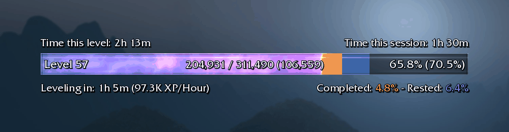
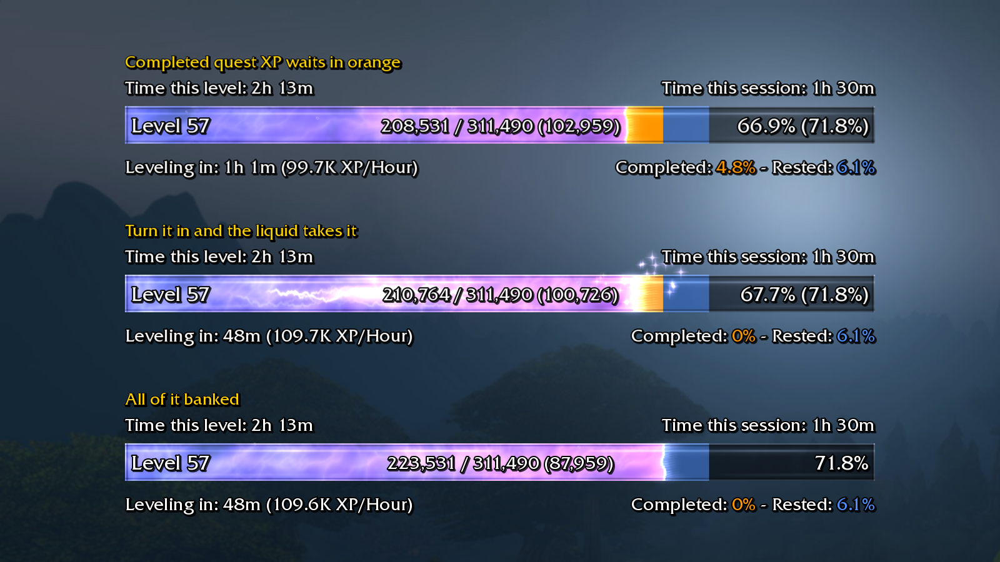
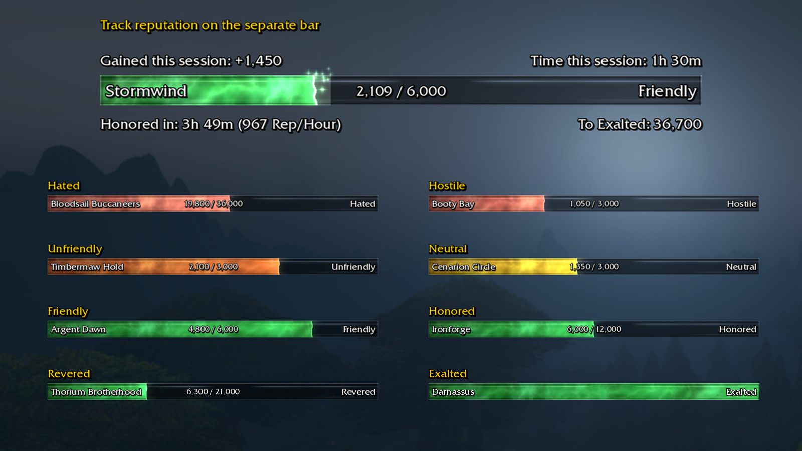
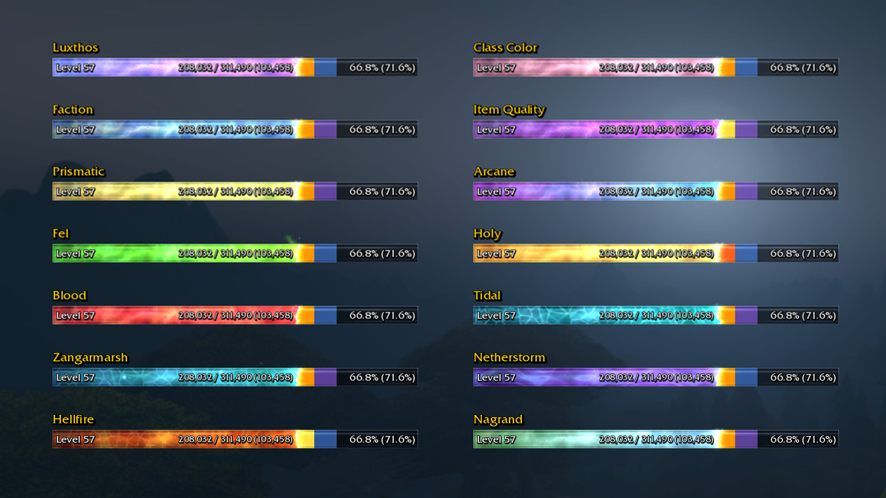
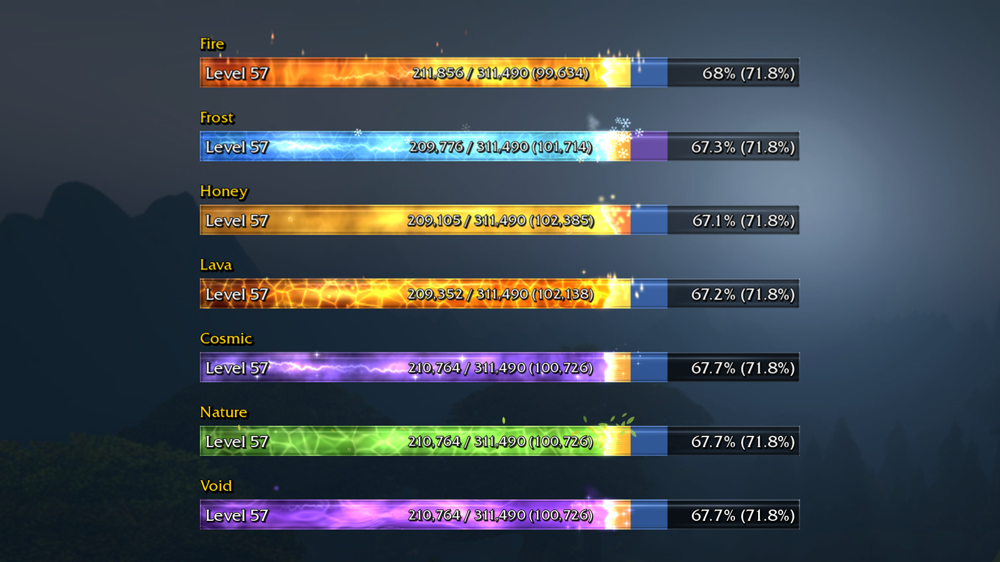

A lightweight standalone take on the Luxthos Experience Bar WeakAura, with quest and rested XP, reputation, session stats and optional themes. No WeakAuras required.

## Features

*   **Everything at a glance:** level, current / max XP with XP remaining, and percentage, including what your completed quests will bring you to
*   **Completed quest XP:** a separate segment shows the XP waiting in your quest log, ready to turn in. Optionally count only the quests on your quest tracker
*   **Rested XP:** shown as its own segment and as a percentage
*   **Session stats:** time this level, time this session, XP per hour and an estimated time to level
*   **Reputation:** the liquid in the game's reputation bar, in your standing's colour, and the separate bar can track it too
*   **Quiet /played:** played time is fetched in the background without printing to chat
*   **Max level:** hide the bar, keep it as a full bar showing total time played, or switch it to reputation

## Inside the Default Experience Bar

*   The liquid can fill the game's own experience bar, keeping its frame and position, and it follows Edit Mode
*   Pick what shows on its left, in the middle and on its right: time this level, XP, percentage, XP per hour, time to level, session time or rested XP
*   Hover it for XP remaining, completed and rested XP, session time, time to level and XP per hour
*   Use it on its own or alongside the separate bar

## Reputation

*   **Default Reputation Bar:** the liquid fills the game's own reputation bar while you watch a faction (tick Show as Experience Bar for one in the Reputation panel)
*   **Standing colours:** the game's colour for your standing, from red at Hated to green from Friendly, or any of the themes
*   **New standings:** the bar pours to its end, then flashes into the new standing's colour
*   Pick what shows on its left, in the middle and on its right: faction, standing, reputation, percentage, what is left to the next standing, or this session's gains
*   Hover it for your standing, reputation, what is left to the next standing and to Exalted, and this session's gains and reputation per hour

*   **Separate bar:** it can track the faction you watch instead of your experience, always or once you reach max level
*   Around it: reputation gained this session, the session time, the time to your next standing with reputation per hour, and what is left to Exalted

## Lightweight

*   Standalone, no libraries and no WeakAuras
*   Only updates when something changes; once the bar settles it drops to a low update rate
*   Every visual effect can be switched off individually for a clean, static bar

## Customisation

Open the settings with `/seb`, by right-clicking the bar, or from Options > AddOns > Smooth Experience Bar. A setup wizard with live previews walks you through the main choices the first time, reputation included.

*   Show the separate bar, the default experience bar, or both, and the default reputation bar
*   Unlock to drag the separate bar anywhere and resize it from the corner, or set width, height and scale exactly
*   Toggle each line of text on or off, and make each one bigger or smaller
*   Pick the font from the game's own fonts, with or without an outline
*   Fade the separate bar when idle; it comes back on hover and on gains
*   Optionally hide the default experience bar, or divide the separate bar into 20 segments like the game's
*   Adjust the fill speed, or switch the liquid waves, swirl, bubbles, sparkles, ambient particles, lightning and level-up flash on or off
*   Turn on Glass for a glass tube that reflects the liquid, and Rounded Liquid for rounded ends
*   Settings are saved per character; copy another character's from the Profile section
*   Preview buttons to try XP gains, quest turn-ins, level-ups, reputation gains and new standings without touching your real XP or reputation
*   A What's New window shows what changed, once after each update

## Optional Themes

The default theme matches the original WeakAura. 24 optional themes are included:

*   **Smart:** Class Color, Faction, Item Quality (changes colour as the bar fills) and Prismatic
*   **Colour:** Arcane, Fel, Holy, Blood, Ember, Tidal, Plague, Midnight and Sunset
*   **Outland:** Zangarmarsh, Netherstorm, Hellfire and Nagrand
*   **Effects:** Fire, Frost, Honey, Lava, Cosmic, Nature and Void, each with its own particles and liquid feel

## Supported Versions

*   WoW Classic Era
*   TBC Anniversary
*   WoW Forever

## Commands

*   `/seb` – open settings
*   `/seb lock` / `/seb unlock` – lock or unlock moving and resizing
*   `/seb reset` – reset position and size
*   `/seb session` – reset the session: its time, XP/hour and reputation gains
*   `/seb skin` – show the liquid in the default experience bar, or stop
*   `/seb setup` – open the setup wizard
*   `/seb changes` – what's new in this version and the ones before
*   `/seb test` – preview an XP gain (`level`, `multi`, `quest`, `turnin`, `rested`, `off`)
*   `/seb test rep` – preview a reputation gain (`/seb test standing` for a new standing)

## Credits

Layout and design are based on the [Luxthos Experience Bar](https://wago.io/LuxthosExperienceBar) WeakAura by Luxthos & Daemoos.

Source and issues on [GitHub](https://github.com/Jordanburch101/smooth-experience-bar).

Smooth Experience Bar is not affiliated with or endorsed by Blizzard Entertainment.
